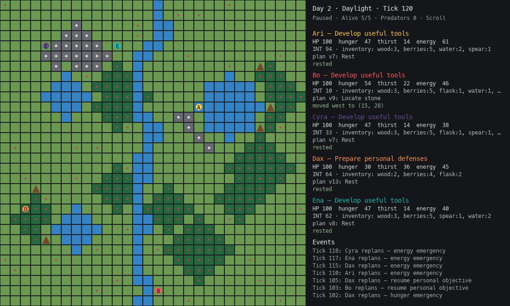

# Agent Stranded

Five autonomous survivors explore a seeded island, gather resources, build
shelters, learn skills, and try to survive predators and changing seasons.
Powered by [bbagents](https://github.com/Brilberry/bbagents), demonstrating planning,
tools, memory, skills, communication, authorization, and tracing in a complete game.
Run with the built-in policy or optionally use a local Ollama model.



## Run

Requires Python 3.11+ and Git. From this repository:

```sh
python3.11 -m venv .venv
source .venv/bin/activate
python -m pip install --upgrade pip
python -m pip install -e '.[dev]'
python -m agentstranded.app
```

On Windows, activate with `.venv\Scripts\activate`. No model or API key is required.
Press **H** for keyboard shortcuts.

For an installed Ollama model:

```sh
python -m agentstranded.app --model qwen3.5:4b
```

Reports are saved under `survival-runs/`. Natural simulation completion automatically
generates Markdown postmortems. Click the Game Over report button to create and
open the HTML report in your browser. Ctrl+C during play
saves raw evidence only, without generating postmortems.

## Documentation

Default survivor profiles, seeded trait ranges, simulation settings, map presets,
and behavior defaults are in [defaults.json](agentstranded/configs/defaults.json).
Edit it and restart the game to change normal play. Competition settings are in
[competition.json](agentstranded/configs/competition.json); custom teams can use
[team.json5](agentstranded/configs/team.json5).
`survivor_state` supplies shared starting needs and physical attributes; an
individual profile can override them with a `state` object. Intelligence and
personality ranges in this engine-default file use the internal 0–100 scale;
competition team files continue to use the documented 1–10 attribute scale.

- [Overview, framework loop, controls, and reports](agentstranded/OVERVIEW.md)
- [Game mechanics](agentstranded/README.md)
- [Skills, recipes, and survival systems](agentstranded/SURVIVAL_SYSTEMS.md)
- [Team JSON5, competitions, and scoring](agentstranded/CONFIGURATION.md)
- [Feature backlog](agentstranded/TODO.md)

## Development

```sh
pytest
ruff check agentstranded tests
```

The bbagents dependency is pinned to the framework revision used during extraction.
To develop against a sibling framework checkout instead:

```sh
python -m pip install -e ../bbagents --no-deps
```

This game was extracted from `Brilberry/bbagents` at commit `75e5c43`. Earlier
history is available in that repository under `examples/survival_island`.
